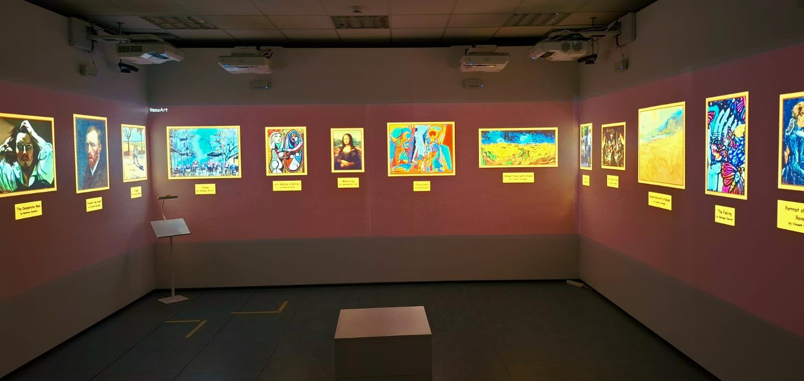
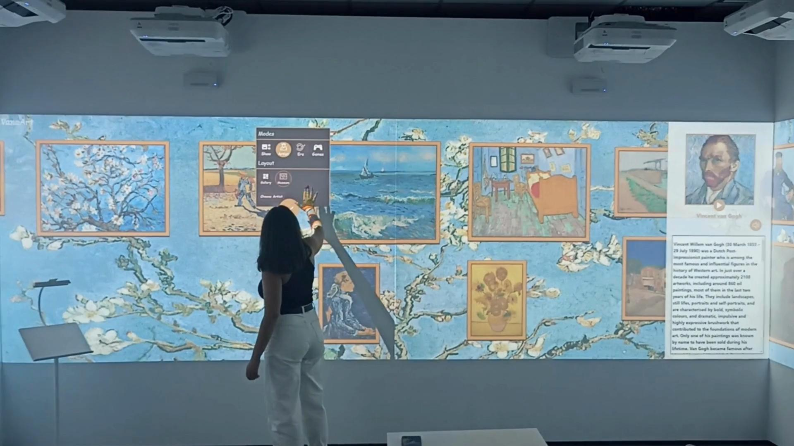
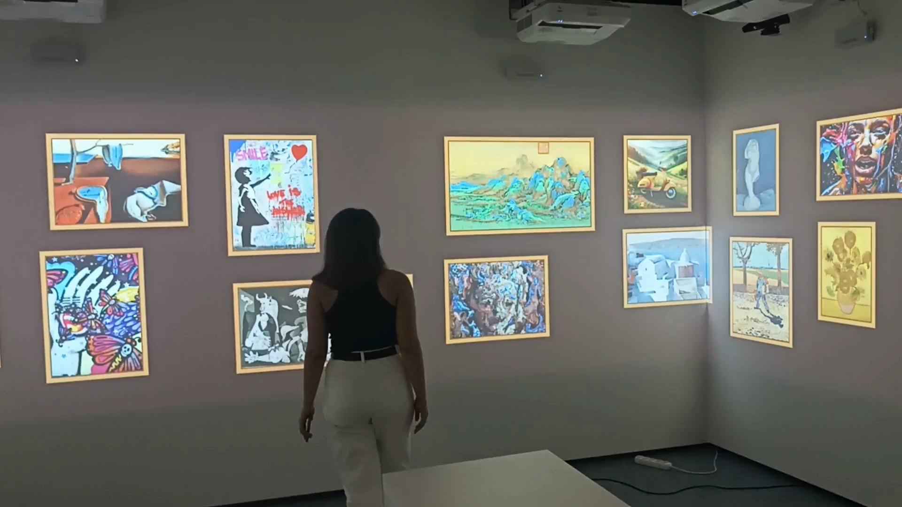
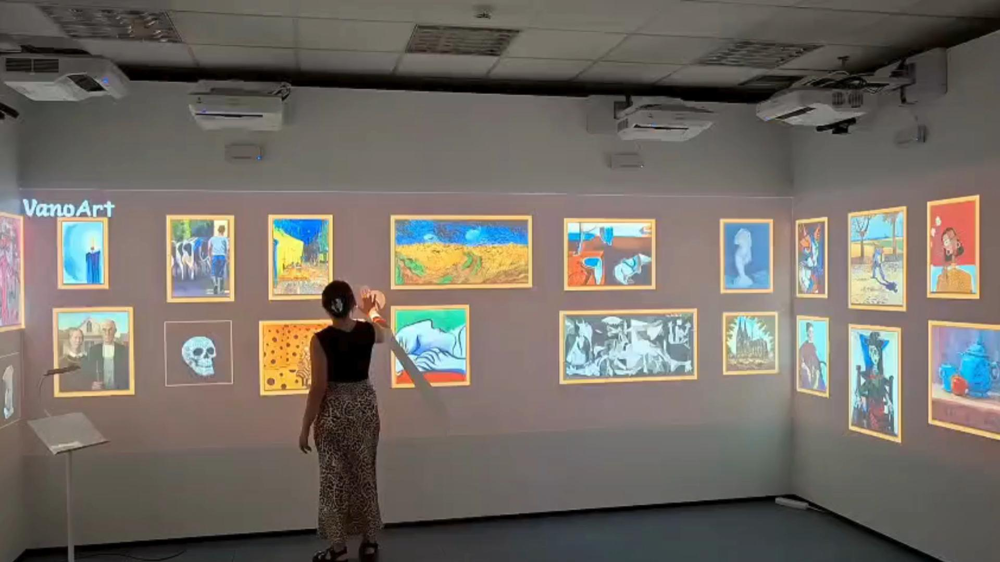
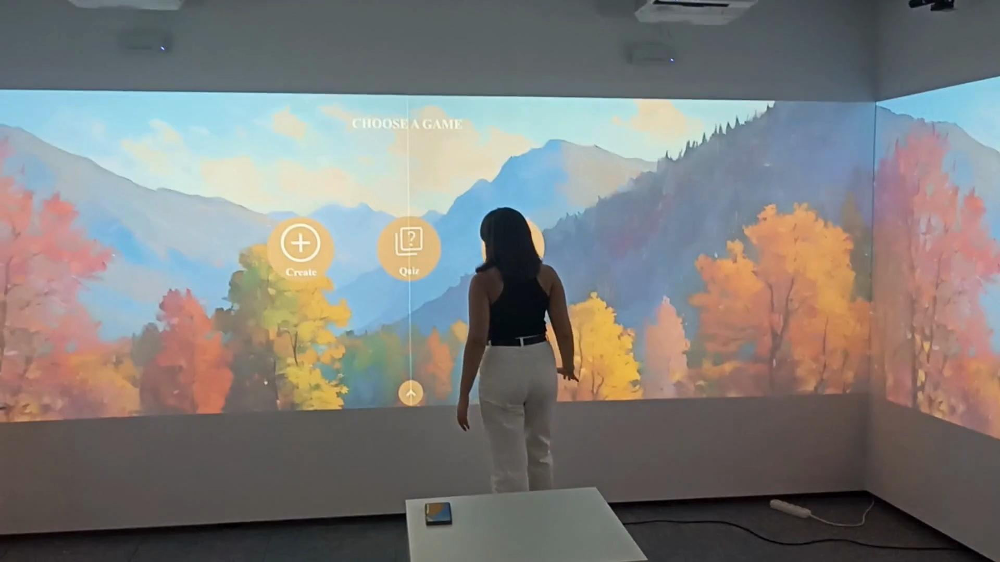
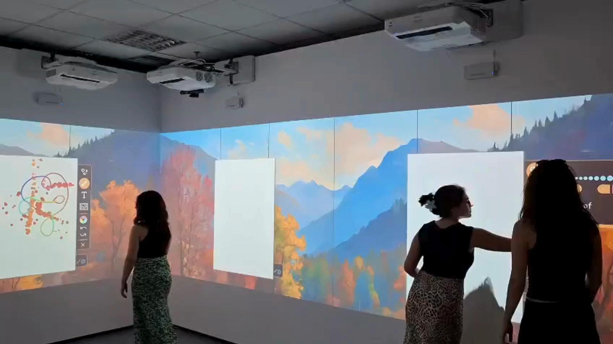
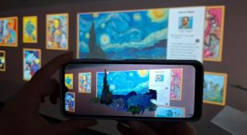
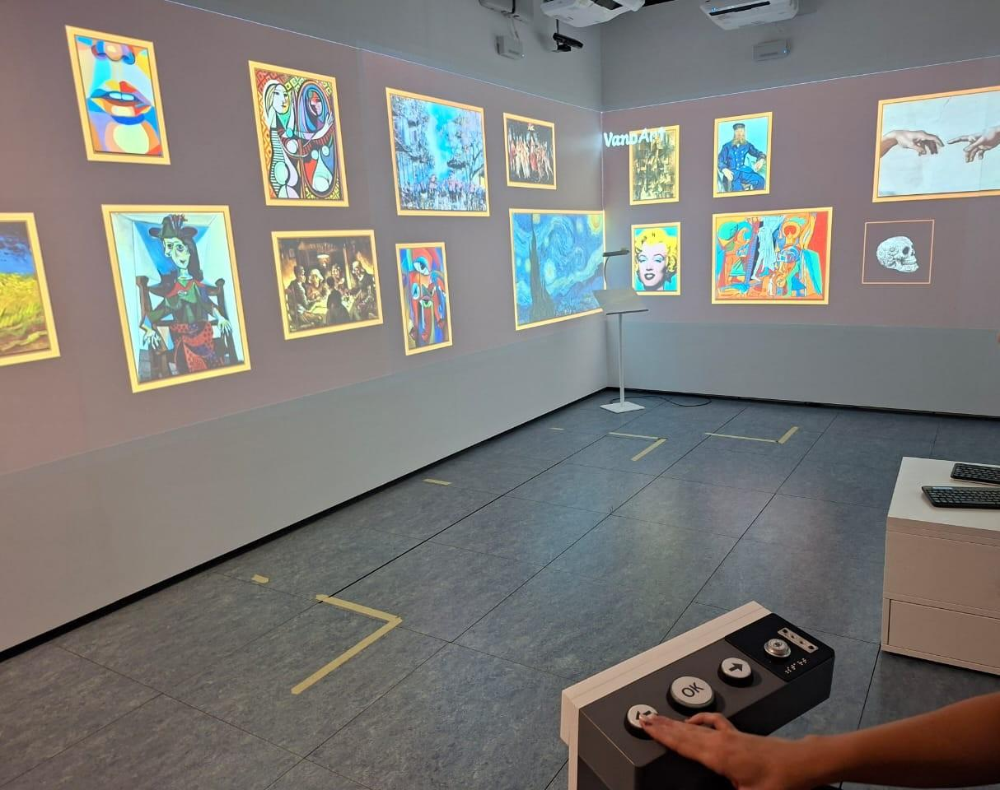
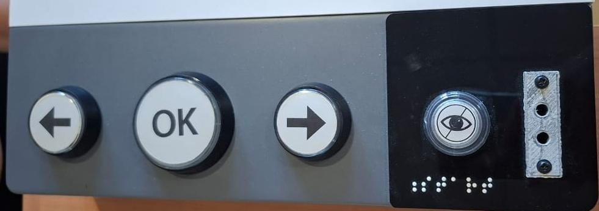
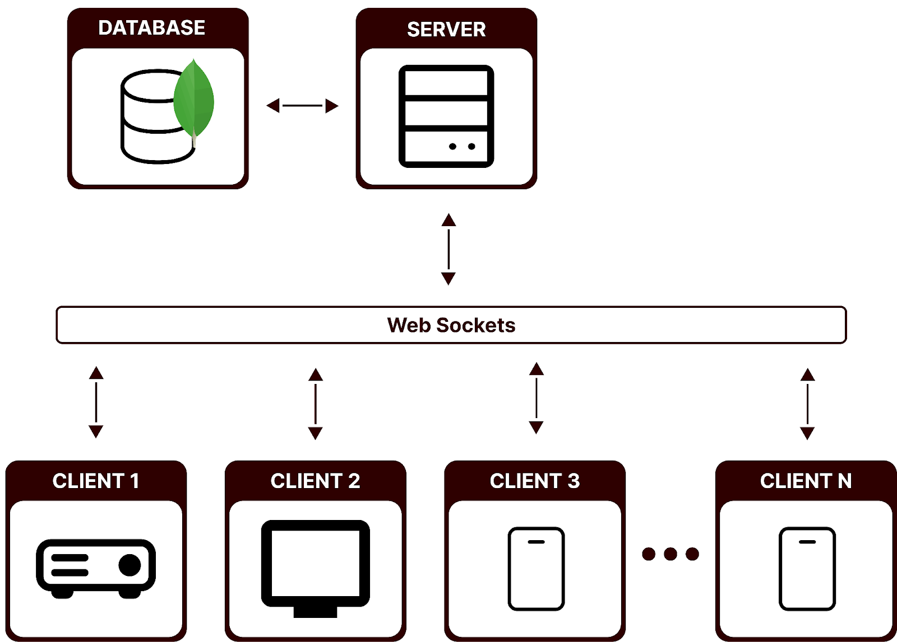

# FRAMES: Immersive & Multimodal Extended Reality Exhibitions

**FRAMES** is a platform for building interactive, immersive exhibitions that combine multi-wall projections, multimodal interaction, gamification and augmented reality. **VanoArt**, an art exhibition of paintings and sculptures, is its first case study. It runs in an XR CAVE and comes with a companion Android application for visitors.

I worked on FRAMES as part of my BSc thesis at the Human-Computer Interaction Laboratory of ICS-FORTH. The work was published at **Digital Heritage International Congress 2025** (Siena, Italy).

> **About the code:** FRAMES was developed at the HCI Lab of ICS-FORTH, and its source code belongs to the lab, so it is not public. This repository presents the project, my role and the results through screenshots, videos and the publication.

---

## My role

- **Co-designed and developed the FRAMES platform:** UI/UX design from wireframes to front-end implementation, interactive and themed exhibition views, and gamified experiences.
- **Single-handedly built the companion Android application** (Unity, C#): painting recognition through the camera, AR overlays on artworks and an in-app e-shop with product availability. The app accompanies an interactive exhibition that will soon be on display.
- **Designed for accessibility:** accessible navigation with a physical controller and auditory information.
- **Evaluation:** took part in a cognitive walkthrough with 5 UX experts and turned the findings into design improvements.

**Technologies:** Angular, JavaScript, MongoDB, WebSockets, Unity (C#), Android

---

## The problem

Museums still rely heavily on static displays and short labels. Visitors increasingly expect interactive, personalized experiences, but museums face limited physical space, accessibility gaps, little contextual information and technology trade-offs. Existing solutions usually focus on a single feature rather than offering a holistic, accessible experience.

**FRAMES** brings these elements together in one modular and scalable platform that adapts to the theme and setting of each exhibition and supports images, video, audio and 3D models.

---

## Key features

| Feature | What it does |
|---|---|
| **Synchronized multi-wall display** | Content flows smoothly across multiple projected walls, synchronized in real time with WebSockets |
| **Multi-user interaction** | Several visitors can explore and interact at the same time |
| **Interactive cards** | Enlarged artworks with information and a QR code to an online companion webpage |
| **Themed & personalized exhibitions** | Filter by artist or artistic period; gallery or museum layouts; fully adaptable environment |
| **Augmented reality** | AR overlays with micro and macro animations, video, audio narration and 3D models |
| **Gamification** | Interactive quiz games and a Virtual Atelier for creating and customizing artwork together |
| **Personal device integration** | Companion Android app for visitors |
| **Accessibility** | Accessible navigation with a physical controller and auditory information |

---

## Gallery

### Themed exhibitions
| Museum layout | Contemporary art theme |
|---|---|
|  |  |

### Interactive cards & personalized exhibition
| Interactive cards | Personalized exhibition |
|---|---|
|  |  |

### Gamification
| Virtual Atelier | Interactive quiz game |
|---|---|
| ) |  |

### Augmented reality on the mobile app

### Accessible navigation
| In the room | Physical controller |
|---|---|
|  |  |

---

## Architecture

A central server and database push content to any number of clients (projectors, displays and mobile devices) over **WebSockets**. This keeps all walls synchronized in real time and makes the platform easy to extend to new layouts.

**Biggest challenge:** keeping smooth, seamless continuity across multiple displays. Inside a CAVE this means real-time synchronization. Beyond the CAVE it also means flexible calibration and alignment for different projector positions, surfaces and lighting.

---

## Videos

<!-- To add a video: edit this file on GitHub and drag & drop an .mp4 file (up to 10 MB on the free plan) right here.
     GitHub uploads it and inserts a link that plays inside the README.
     For longer videos, upload them to YouTube (they can be "Unlisted") and use the thumbnail link below. -->

[Add your videos here: see the instructions in the comment above]

<!-- Example YouTube thumbnail link:

-->

---

## Evaluation

The platform was evaluated through a **cognitive walkthrough with 5 UX experts**, based on guided tasks covering its core features.

- Positive feedback on the concept and implementation
- Smooth transitions and strong spatial continuity
- Themed exhibitions found immersive and novel
- Touch and customizable interactions found intuitive
- AR and gamification found engaging and innovative
- Usability issues identified (navigation, actions, scrolling) and solutions proposed

**Future work:** user-based evaluation, holographic storytelling and refined interaction mechanisms.

---

## Publication

V. E. Pitikaki, E. Troulis, A. Leonidis, M. Korozi, C. Stephanidis. **FRAMES: A Platform for Constructing Immersive and Multimodal Extended Reality Exhibitions.** In *Digital Heritage International Congress 2025*, Siena, Italy. The Eurographics Association, 2025.
DOI: [10.2312/dh.20253130](https://diglib.eg.org/handle/10.2312/dh20253130)

---

## Acknowledgments

Developed at the Human-Computer Interaction Laboratory, Institute of Computer Science, Foundation for Research and Technology – Hellas (FORTH). This work has been supported by the FORTH-ICS internal RTD Programme "Ambient Intelligence and Smart Environments".

**Contact:** Vasia Pitikaki · [LinkedIn](https://www.linkedin.com/in/vasia-pitikaki-1a5525370/) · basia.pitikaki@gmail.com
